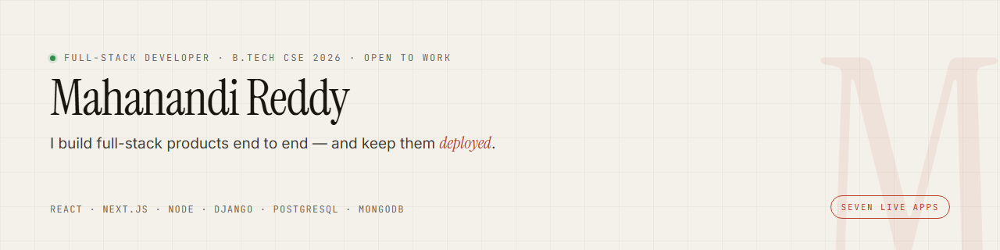

  

# Hi, I'm Mahanandi Reddy

**Full-stack developer** — React · Next.js · Node · Django · PostgreSQL / MongoDB

B.Tech Computer Science, Lovely Professional University (May 2026) · Ongole, India · **open to full-time roles, will relocate**

I build web products end to end — schema, API, UI, deployment — and I keep the demos alive. Seven of my apps are deployed right now; the links below are real deployments, not screenshots.

I care about the parts of a project that survive review: auth that holds, seed data that seeds, empty states that read well, and a README someone can actually follow.

---

### Selected work

| Project | What it does | Stack | Links |
| --- | --- | --- | --- |
| **WorkProof** | A work journal that records what you shipped and the skills it taught you — entries, skill map, streaks, badges, private proof files. | Next.js · TypeScript · Prisma · PostgreSQL · Supabase | [Live demo](https://work-proof-tracker.vercel.app/demo) · [Code](https://github.com/madhire34/work-proof-tracker) |
| **ShopAdmin** | E-commerce control room: KPI cards, SVG revenue curve, category donut, conversion funnel, order table. Seed-data fallback keeps the demo alive. | React · Vite · Express · MongoDB · JWT | [Live](https://admindashboard-cedcos-task.vercel.app) · [Code](https://github.com/madhire34/admindashboard-cedcos-task) |
| **ResumeRAG** | Upload PDF résumés, search candidates in plain English, match them to roles with RAG and GPT-4 embeddings. | React · TypeScript · Express · MongoDB · OpenAI | [Live](https://resume-rag-hackathon.vercel.app) · [Code](https://github.com/madhire34/ResumeRag-hackathon) |
| **MHRD Dashboard** | Drill-down analytics over a synthetic India-wide education dataset — KPIs, trends, map insights, CSV export. | Django · DRF · Python | [Live](https://mhrd-dashboard.onrender.com) · [Code](https://github.com/madhire34/mhrd-dashboard) |
| **CipherStudio** | In-browser React IDE with a file tree, Sandpack live preview, JWT accounts, and saved projects. | Next.js · Sandpack · Express · MongoDB | [Live](https://cipherschools-react.vercel.app) · [Code](https://github.com/madhire34/cipher_studio) |
| **NeighborFit** | Rate safety, walkability, nightlife and budget; a transparent weighted model ranks the neighborhoods that fit. | React · Express · MongoDB | [Live](https://neighborfit-self.vercel.app) · [Code](https://github.com/madhire34/neighborfit) |
| **CampusConnect** | Two university landing pages with Django JSON endpoints and a Pipedream lead-capture webhook. | Django · Pipedream | [Live](https://campusconnect-pcbw.onrender.com/) · [Code](https://github.com/madhire34/CampusConnect) |

> Some demos run on free tiers. If one takes ~30 seconds to load, it's waking up — the app itself is live.

---

### Stack

`TypeScript` `JavaScript` `Java` `Python` `SQL` · `React` `Next.js` `Tailwind CSS` `Vite` · `Node.js` `Express` `Django` `Django REST Framework` · `PostgreSQL` `MongoDB` `MySQL` `Prisma` `Mongoose` · `OpenAI API` `RAG` · `Git` `Vercel` `Render` `Supabase`

---

### How I work

- **Own the whole slice** — schema to UI to deploy, not just the screen.
- **Make it survive review** — demo modes, seeded fallbacks, no dead ends.
- **Write it down** — setup steps, architecture, trade-offs, next steps.

---

### Elsewhere

[Portfolio](https://madhire34.github.io) · [LinkedIn](https://www.linkedin.com/in/mahanandi08/) · [Email](mailto:madhirereddy4@gmail.com) · +91 90306 87406
